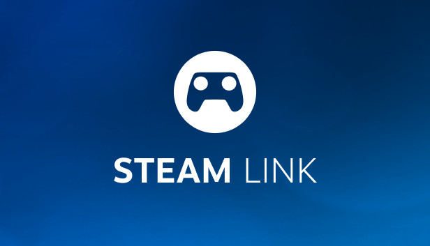

# Steam Link for Android XR — patched builds

  

  
  
  
  

  Ready-to-install Steam Link (PCVR) APKs for the <b>Samsung Galaxy XR</b> and other Android XR headsets. 
  Already patched. Nothing to apply on the headset.

## What this is

Valve's Steam Link PCVR app only ships for Meta Quest and Pico. This repository holds **pre-patched builds** of that app for Android XR headsets: resolution, color, controller tracking, microphone and app-startup fixes are already compiled in. Install the APK and launch it.

The patch sources live in [**xr-porting-hub**](https://github.com/AngelDark92/xr-porting-hub). This repository only publishes the finished APKs, with no source code.

## Downloads

| Steam Link | Build | Patch set | Driver | Release |
|---|---|---|---|---|
| **2.0.20** (recommended) | 5001712 | XR Porting Hub 2.4.0 | v1.15.0 | [Download](https://github.com/AngelDark92/steamlink-androidxr-patched/releases/tag/v2.0.20-2.4.0) |
| **2.0.24** (reference) | 5002395 | XR Porting Hub 2.4.0 | v1.15.0 | [Download](https://github.com/AngelDark92/steamlink-androidxr-patched/releases/tag/v2.0.24-2.4.0) |

Install **2.0.20**: it is the recommended build and the release marked Latest. **2.0.24** is the newest Steam Link version, but it has problems on some configurations, so it is published for reference only. 2.0.23 is no longer offered.

## Requirements

<table>
<tr><td width="120"></td><td>
<b>PC side:</b> <a href="https://github.com/AngelDark92/GalaxyXR-Driver/releases/tag/v1.15.0">Galaxy XR Companion driver v1.15.0</a>, installed and verified in SteamVR. 
The driver gives the headset its native identity, panel resolution and controller tracking, and owns the vrlink stream settings these builds expect. Without it the stream falls back to generic vrlink defaults.
</td></tr>
</table>

- Samsung Galaxy XR (SM-I610) or another Android XR headset, Android 14 or newer.
- PC with Steam and SteamVR, wired or 5 GHz Wi-Fi.
- No root, no Shizuku, no Morphe Manager required on the headset.

## Install

1. Uninstall the existing Steam Link app on the headset. These builds are signed with the patch tool's key, so they cannot update over a store install.
2. Install the APK — `adb install -r Steam_Link-v2.0.20-XR_Porting_Hub-v2.4.0.apk`, or copy it to the headset and open it.
3. Launch Steam Link, allow the permission prompts, and set Battery usage to **Unrestricted** if the page appears.
4. Start SteamVR on the PC and connect.

Stream quality, resolution and image processing are configured **on the PC** in Galaxy XR Companion, not in the app.

## What is patched

- **Android XR startup and permissions** — the app runs on a non-Meta device: manifest, activity launch, storage and microphone grants.
- **Native resolution** — panel-native 3552×3840 per eye instead of the Meta default.
- **Color and OLED calibration** — 8-bit color path, P3/SDR handling, dithering for the Galaxy XR panel.
- **Controllers** — Galaxy XR input profile, grip pose correction, velocity frame and pose extrapolation for throw accuracy; optional Shizuku haptics.
- **Audio and tracking** — microphone fixed for Android XR; OSC face and eye tracking available on the PC side.
- **Codecs** — v8 codec support with stability and crash fixes.
- **Spacewarp** — Async Spacewarp with carrier generation tracking, context-safe resource ownership and a dormant fast path; half-rate synthesis retired.

Full patch list, options and per-build notes: [xr-porting-hub](https://github.com/AngelDark92/xr-porting-hub).

## Versions

Every file name and release tag carries both numbers: `Steam_Link-v2.0.20-XR_Porting_Hub-v2.4.0.apk` → tag `v2.0.20-2.4.0`.

- **2.0.20** / **2.0.24** — Valve's Steam Link build that gets patched.
- **XR Porting Hub 2.4.0** — patch set version, matching the `xr-porting-hub` release. Bumped every time a patch feature is added or fixed, and every supported Steam Link version is rebuilt.

Older patch sets used `-patches-v<version>` in the file name; the tag format is unchanged.

A new patch set means new APKs here. Watch **Releases** for them.

## Links

- Driver and Companion app — [GalaxyXR-Driver](https://github.com/AngelDark92/GalaxyXR-Driver)
- Patch sources and changelog — [xr-porting-hub](https://github.com/AngelDark92/xr-porting-hub)
- Problems with a build — [open an issue](https://github.com/AngelDark92/steamlink-androidxr-patched/issues)

## Notes

Unofficial builds. Not affiliated with or endorsed by Valve or Samsung. Steam Link is Valve's software: own it on Steam before installing. Controller tracking patches are based on [@4uva4ek](https://github.com/4uva4ek)'s Galaxy XR modules, built with [Morphe](https://morphe.software).
